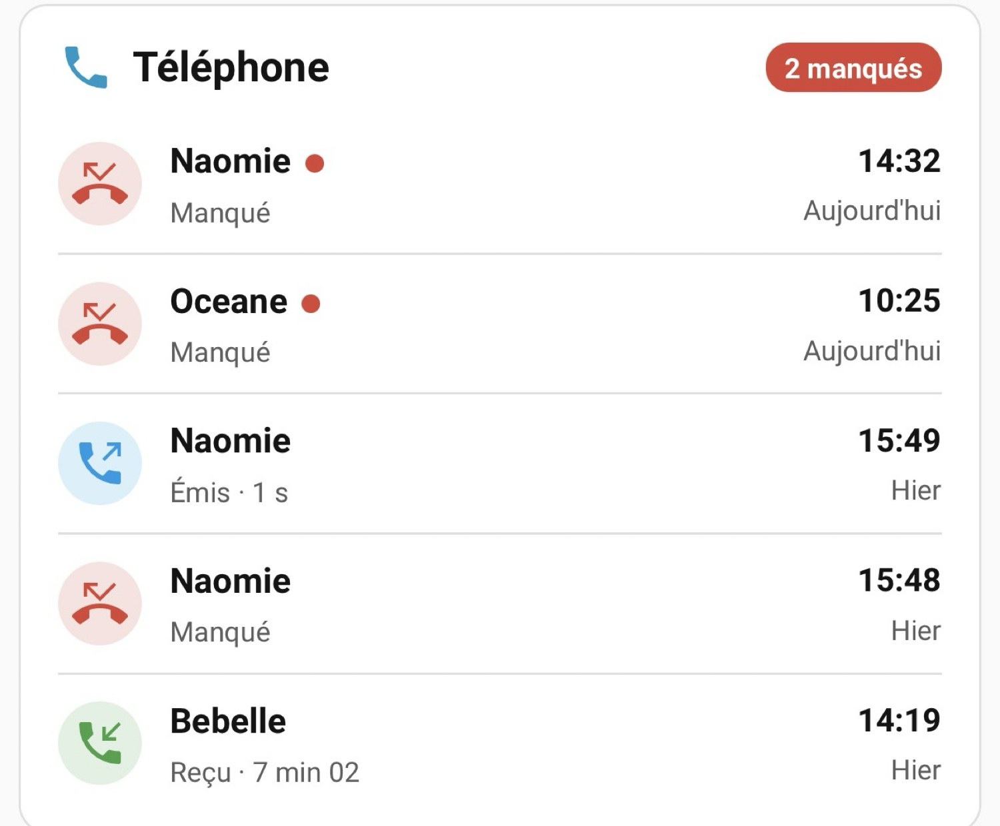
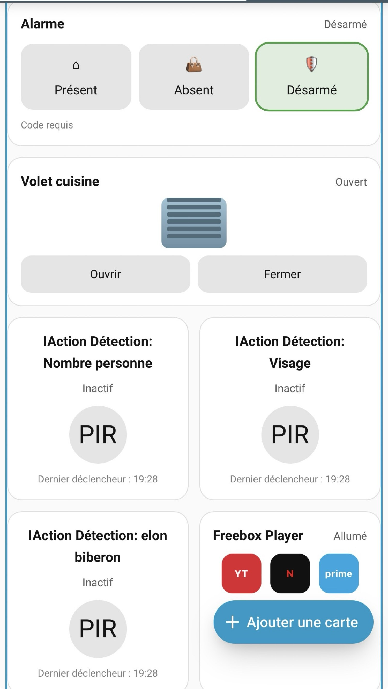
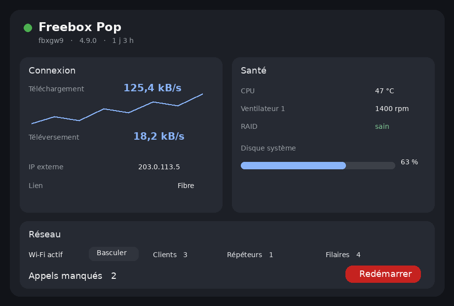

[](https://hacs.xyz) [-32%20done%20%2F%206%20todo%20%2F%2016%20exempt-blue)](https://github.com/XAV59213/freebox_homexa/blob/main/custom_components/freebox_homexa/quality_scale.yaml) [](https://github.com/XAV59213/freebox_homexa/releases/latest) [](https://github.com/XAV59213/freebox_homexa/actions/workflows/hassfest.yaml) [](https://github.com/XAV59213/freebox_homexa/actions/workflows/validate.yaml) [](LICENSE) [](https://github.com/XAV59213/freebox_homexa/releases) [](https://github.com/XAV59213/freebox_homexa/releases/latest) [](https://www.home-assistant.io) [](https://forumdomotique.com/forums/topic/101-pr%C3%A9sentation-du-projet-freebox_homexa/) [](https://xav59213.github.io/forumdomotique/) [](https://github.com/XAV59213/freebox_homexa/stargazers)

[](https://www.buymeacoffee.com/xav59213)

## Via HACS (recommandé)

> [!TIP]
> 🎉 **Freebox Homexa est maintenant disponible directement dans la bibliothèque HACS / Marketplace.**
> Plus besoin d’ajouter le dépôt personnalisé : cherche simplement « Freebox Homexa » dans HACS.

[](https://my.home-assistant.io/redirect/hacs_repository/?owner=XAV59213&repository=freebox_homexa&category=integration)

[](https://my.home-assistant.io/redirect/config_flow_start/?domain=freebox_homexa)


[](https://github.com/XAV59213/freebox_homexa/commits/main)

# Freebox Homexa

Intégration **Home Assistant** pour la Freebox Server, Freebox Home, les répéteurs Wi-Fi Free et le Freebox Player.

**Version actuelle :** [28.8.105](https://github.com/XAV59213/freebox_homexa/releases/tag/28.8.105) · Home Assistant **2026.8.0+**

Wiki : [Documentation](https://github.com/XAV59213/freebox_homexa/wiki)

> Projet indépendant, non affilié à Free.

---

## Fonctionnalités

| Domaine | Ce que ça fait |
|---|---|
| Freebox Server | État, réseau, Wi-Fi, capteurs connexion |
| Freebox Home | Détection auto : interrupteurs, caméras, volets, PIR, contacts |
| Alarme | 3 modes comme l’app Free : **Présent / Absent / Désarmé** |
| Appareils Wi-Fi | Suivi des clients + **RSSI (dBm)**, bande, SSID, AP / répéteur |
| Répéteurs Free | F-RP01A : capteur *En ligne* + clients |
| Player | Devialet, Mini 4K, Pop : volume, play/pause, sources |
| Télécommande | Entité `remote` + sources TV / HDMI (CEC) / YouTube / Netflix |

HDMI sur le Player = **sortie vers le téléviseur** (CEC One Touch Play), pas un changement d’entrée HDMI de la TV.

---

## Installation (HACS)

> [!TIP]
> 🎉 **Freebox Homexa est maintenant disponible directement dans la bibliothèque HACS / Marketplace.**
> Plus besoin d’ajouter le dépôt personnalisé : cherche simplement « Freebox Homexa » dans HACS.

[](https://my.home-assistant.io/redirect/hacs_repository/?owner=XAV59213&repository=freebox_homexa&category=integration)

1. HACS → recherche **Freebox Homexa**
2. Clique sur **Télécharger**, puis redémarre Home Assistant
3. Ajoute l’intégration : **Paramètres → Appareils et services → Ajouter une intégration → Freebox Homexa**

> Le dépôt personnalisé (`https://github.com/XAV59213/freebox_homexa`) n’est plus nécessaire. Si tu l’avais ajouté, tu peux le retirer de **HACS → Dépôts personnalisés** sans perdre l’intégration.

Installation manuelle : copie le dossier `custom_components/freebox_homexa` dans `/config/custom_components/` puis redémarre.

---

## Configuration


1. **Paramètres → Appareils et services → Ajouter une intégration**
2. Cherche **Freebox Homexa**
3. Host Freebox (souvent `mafreebox.freebox.fr` ou `xxx.fbxos.fr`)
4. Valide l’appairage **sur l’écran de la Freebox**
5. Dans [Freebox OS → Paramètres → Applications](http://mafreebox.freebox.fr/#Fbx.os.app.settings.Accounts), accorde les droits à l’application Home Assistant (Home, Player, LAN, etc.)

Pas besoin de coller un token dans `configuration.yaml` : tout passe par l’interface.

### Options (clients LAN)

Dès l’installation, ou ensuite : **Paramètres → Appareils et services → Freebox Homexa → Configurer**.

| Option | Défaut | Intérêt |
|---|---|---|
| Suivre les clients LAN | oui | `device_tracker` des téléphones / PC / objets |
| Créer les capteurs RSSI Wi-Fi | oui | Signal en dBm dès que le client est vu en Wi-Fi |
| Créer des appareils pour les clients réseau | non pour une nouvelle installation ; oui conservé pour une installation existante (migration automatique) | Activé : un appareil par client, rangé sous « Clients réseau filaires / Clients Wi-Fi › type » ou son répéteur, avec les capteurs « Clients connectés ». Désactivé : comportement standard de Home Assistant — le `device_tracker` ne crée pas d’appareil et se relie seul à l’appareil d’une autre intégration ayant la même MAC ; le RSSI reste une entité seule ; pas de groupes de clients. En désactivant, les appareils clients créés par Homexa seuls sont retirés au rechargement (ceux partagés avec une autre intégration sont gardés) |
| Intervalle Home (secondes) | 15 | PIR, contacts, alarme, volets : 5 / 10 / 15 / 20 / 25 / 30 |
| Code télécommande Player | vide | 8 chiffres, Player : Réglages → Système → Informations |

Le Server, les répéteurs et le pack Home (alarme, PIR, caméras, volets) gardent toujours leurs devices.

« Créer des appareils pour les clients réseau » :

- **décochée par défaut** sur une nouvelle installation : règle de Home Assistant, un `device_tracker` ne crée pas d’appareil. Home Assistant crée alors **désactivé** le tracker d’un client qu’aucune autre intégration ne connaît : activez-le dans la liste des entités si besoin (comme avec l’intégration Freebox officielle) ;
- **installation existante** (avant la 28.8.62) : l’option est conservée **cochée** à la mise à jour, rien ne change ;
- en la décochant après coup : au rechargement, les appareils clients créés **uniquement** par Homexa sont retirés automatiquement ; un appareil partagé avec une autre intégration (Shelly, ESPHome…) est conservé.

Pour 5 s, désactivez l’intégration officielle Freebox : les deux en parallèle saturent l’API.

### Organisation des appareils

Les appareils Homexa sont rangés sous **4 services de premier niveau** :

| Service | Contenu |
|---|---|
| **Freebox Server** (ex. « Freebox v7 (r1) ») | entités du serveur (débits, températures, Wi-Fi, redémarrage, appels manqués, « Marquer les appels comme lus »…) ; enfants : répéteurs Wi-Fi, disques, clients réseau (si l'option est activée), caméras IP |
| **Freebox Player** | chaque Player (lecteur, télécommande, boutons d'applis) |
| **Freebox Maison connectée** | entités du module d'alarme ; enfants : tous les nœuds Freebox Home (détecteurs, fenêtres, volets, ouvrants, RTS / IO, caméras Freebox Home, prises…) |
| **TNT** | calendrier « Guide TV » et capteurs « Programme TNT FR » |

Les anciens groupes (Sécurité, Volets, Réseau et ses sous-groupes, Caméras, Journal d'appels, Guide TV Freebox, Équipements…) sont retirés environ 2 minutes après le chargement, **uniquement s'ils n'ont plus ni entité ni appareil enfant** ; aucune entité n'est supprimée.

**Forcer un service** : Configurer → **Groupes des appareils** liste les appareils Homexa (avec leur service automatique entre parenthèses). Choix : Automatique, Freebox Server, Freebox Maison connectée, Freebox Player, TNT. Les choix enregistrés avec les anciens groupes sont migrés automatiquement (Sécurité / Fenêtres / Volets → Maison connectée, Multimédia → Player, Guide TV → TNT, Caméras → Automatique, le reste → Freebox Server).

- Les identifiants d'entités ne changent pas ; les appareils existants sont re-rattachés au rechargement.
- **Pièce suggérée** déduite du nom (« Volet cuisine » → Cuisine, « Fenêtre Papa » → Papa…). Home Assistant ne l'applique **qu'à la création** d'un appareil : les appareils existants gardent leur pièce.
- Les clients sans nom (« Unknown device », « wlan0 », adresse MAC) prennent un autre nom d'hôte connu, sinon « <fabricant> <fin de MAC> ».

### Player (télécommande)

Le **code télécommande réseau** (8 chiffres) se règle dans **Configurer**, sous l’intervalle Home.

Sur le Player : **Réglages → Système → Informations**. Utile sur Révolution / Delta / Devialet pour power, TV, chiffres. Mini 4K / Pop passent souvent par **Android TV Remote**. Laisser vide si vous n’avez pas de Player.

Volume et lecture passent par l’API Player, sans ce code.

### Lire un MP3 (sirène, annonce)

`media_player.play_media` lit une adresse HTTP ou HTTPS sur le Player quand le type est `audio/mpeg` (ou un autre `audio/*`), `music`, ou absent si le fichier finit par `.mp3`, `.aac`, `.ogg`, `.wav` ou `.flac`. Le Player la reçoit par AirMedia, comme un message vocal. Le changement de chaîne `tv:?channel=N` et la vidéo restent inchangés.

Le fichier doit être joignable par le Player, par exemple `http://homeassistant.local:8123/local/sirene.mp3` (dossier `config/www`). Si la lecture ne démarre pas, l'action échoue avec un message au lieu de laisser la chaîne TV en cours.

```yaml
alias: Sirène du Player quand l'alarme se déclenche
triggers:
  - trigger: state
    entity_id: alarm_control_panel.systeme_d_alarme
    to: triggered
    not_from:
      - unavailable
      - unknown
actions:
  - action: media_player.play_media
    target:
      entity_id: media_player.freebox_player
    data:
      media_content_id: http://homeassistant.local:8123/local/sirene.mp3
      media_content_type: audio/mpeg
```

---

## Actions

| Action | Rôle |
|---|---|
| `freebox_homexa.reboot` | Redémarre la Freebox |
| `freebox_homexa.reload` | Recharge l’intégration (reconnexion, redécouverte des appareils Home) |
| `freebox_homexa.remote` | Envoie des touches de télécommande au **Freebox Player** |
| `freebox_homexa.schedule_reminder` | Programme un rappel TNT (notification et/ou annonce vocale) 5, 10 ou 15 min avant un programme |
| `freebox_homexa.cancel_reminder` | Annule un rappel TNT |
| `freebox_homexa.get_reminder_status` | Indique si un rappel est programmé (réponse de l’action) |
| `freebox_homexa.start_fxs_ring` | Fait sonner le téléphone du port FXS, avec une durée facultative |
| `freebox_homexa.stop_fxs_ring` | Arrête la sonnerie du port FXS |
| `freebox_homexa.start_dect_ring` | Fait sonner les combinés DECT (30 s par défaut, 1 à 300 s) |
| `freebox_homexa.stop_dect_ring` | Arrête la sonnerie DECT |
| `freebox_homexa.mark_voicemail_read` | Marque un message vocal comme lu |
| `freebox_homexa.delete_voicemail` | Supprime un message vocal |
| `freebox_homexa.play_voicemail` | Lit un message sur un lecteur média, puis le marque lu |

Avec plusieurs Freebox, `config_entry_id` ou `device_id` choisit la Freebox visée par `reboot`, `reload`, `remote`, les sonneries et la messagerie.

### Sonnerie du téléphone (port FXS)

Deux boutons sur le Freebox Server : **Démarrer la sonnerie FXS** et **Arrêter la sonnerie FXS**. La même chose existe en actions, pour les automatisations. Il faut le droit **Téléphonie** de l’application Home Assistant dans Freebox OS (Paramètres → Gestion des accès → Applications). Sans ce droit, ou si la box n’a pas de port FXS, l’action échoue avec un message traduit : ce n’est pas un succès.

Sans durée, la sonnerie continue jusqu’à l’arrêt. Avec `duration` (1 à 300 secondes), Homexa demande **toujours** l’arrêt, y compris si l’action échoue, est annulée ou si l’intégration est déchargée.

```yaml
action: freebox_homexa.start_fxs_ring
data:
  duration: 5
```

### Sonnerie DECT

Les boutons **Faire sonner les combinés DECT** et **Arrêter la sonnerie DECT** n'apparaissent que si `phone/` renvoie au moins un combiné de type DECT. L'action sans `duration` sonne 30 secondes. L'arrêt est toujours demandé. Chaque combiné ajoute **Sonne** (`is_ringing`) et **Décroché** (combiné pas sur son socle). Ce second état reprend `on_hook` tel que la Freebox le donne : le firmware peut l'omettre ou le mettre à jour en retard, le capteur reste alors inconnu. Aucun numéro n'est lu.

```yaml
action: freebox_homexa.start_dect_ring
data:
  duration: 30
```

### Messagerie vocale

Le capteur **Messages vocaux non lus** compte les messages non lus. Ses attributs donnent le total, la date du plus récent, `voicemail_available`, `voicemail_supported`, `voicemail_error` et une liste (jeton, date, durée, lu) **sans numéro**. Un nouveau message non lu, après le premier relevé, émet `freebox_homexa_new_voicemail` (jeton, durée, date, `caller`, `name`). Le jeton n'est pas le nom de fichier Freebox. Si la Freebox n'a pas de messagerie, le capteur reste disponible avec `voicemail_supported: false` et la carte affiche « Messagerie vocale non disponible sur cette Freebox ».

Un nouvel appel manqué, après le premier relevé du journal, émet `freebox_homexa_missed_call` (`entry_id`, `date`, `caller`, `name`). `caller` est le nom du contact, ou le numéro si l'option **Inclure le numéro dans les événements** est cochée. Sinon, sans contact, `caller` vaut `Inconnu` et le numéro n'est pas dans l'événement. L'option est décochée par défaut. Les options déjà enregistrées ne changent pas. Aucun numéro n'est journalisé. Quand l'option est cochée, `number_spoken` est le numéro à faire lire : chiffres groupés deux par deux (« 06, 12, 34, 56, 78 »), un `+33` ou `0033` devenant `0`, et un numéro masqué lu « numéro masqué ». Le même champ est sur `freebox_homexa_new_voicemail`. Homexa n'envoie pas elle-même l'annonce à Alexa. Quand l'option est cochée, `number_spoken` est le numéro à faire lire : chiffres groupés deux par deux (« 06, 12, 34, 56, 78 »), un `+33` ou `0033` devenant `0`, et un numéro masqué lu « numéro masqué ». Le même champ est sur `freebox_homexa_new_voicemail`. Homexa n'envoie pas elle-même l'annonce à Alexa.

La carte **Homexa Téléphone** (chargée avec les autres cartes Homexa, sans ressource Lovelace à ajouter) regroupe les sonneries, l'état des combinés, la messagerie et, si on l'active, les derniers appels. Le numéro reste masqué tant que `show_number` n'est pas coché. On peut écouter dans le navigateur (MP3), ou envoyer le message à un ou plusieurs lecteurs, puis le marquer lu ou le supprimer (avec confirmation). La liste affichée est celle du capteur : un rafraîchissement vide ne la cache pas. Si le chargement dépasse 15 secondes, ou si la lecture échoue, la carte affiche l'erreur et un bouton Réessayer au lieu de rester sur « Chargement ». Avant la lecture sur un lecteur, le volume passe au pourcentage de l'option `voicemail_volume` (50 par défaut) quand le lecteur le permet, puis retrouve son volume d'origine à la fin du message si personne ne l'a modifié. 0 laisse le volume inchangé.

Dans l'éditeur visuel : titre, Freebox, lecteurs, afficher le numéro, derniers appels et nombre d'appels. Les lecteurs proposés sont le Freebox Player (`freebox_homexa`) et Music Assistant. Une carte déjà réglée avec `media_player: media_player.salon` continue de fonctionner : cette clé est lue comme une liste d'un seul lecteur. Si cette liste contient `alexa_devices` ou `alexa_media`, ces lecteurs n'apparaissent ni dans le sélecteur ni dans le menu. Si l'intégration n'est pas connue, il reste et l'éditeur l'indique. Avec un seul lecteur retenu, le bouton affiche « Sur » et le nom court. Avec plusieurs, « Écouter sur… » ouvre les noms ; deux lecteurs du même nom restent distingués par l'intégration ou l'entity_id. Le choix appelle `play_voicemail` et le navigateur retient le dernier choix. Après un envoi réussi, un mini-lecteur suit l'état du lecteur (lecture, pause, progression, volume, stop) et se ferme d'un bouton. S'il n'a pas démarré au bout de dix secondes, le mini-lecteur le dit, sans adresse. Quand le message se termine, ou avec Stop, la carte arrête le lecteur seulement si c'est encore ce message : Music Assistant vide sa file si elle le permet, le Freebox Player arrête AirMedia et retrouve sa source précédente quand elle est connue. Le titre affiché est « Message vocal Freebox ». Si le lecteur refuse, la carte affiche le code d'erreur, sans l'adresse du message.

```yaml
type: custom:homexa-phone-card
title: Téléphone
media_players:
  - media_player.salon
  - media_player.cuisine
show_number: false
show_calls: false
```

La lecture est un MP3 signé, valable quelques minutes, y compris pour un lecteur quelconque. Une enceinte jointe par **Music Assistant** doit pouvoir télécharger ce MP3 depuis une **URL HTTPS publique** (Nabu Casa ou l'URL externe des réglages réseau de Home Assistant). Les entités **Alexa Media** et **Alexa Devices** ne lisent pas cette adresse : leur lecture est une recherche ou une commande, pas un flux. L'action le dit et conseille l'entité Music Assistant du même appareil. Sans URL publique pour un autre lecteur distant, l'action échoue avec un message clair au lieu d'un faux succès. Dans les paramètres généraux, **Lecture de la messagerie sur un lecteur** est activée par défaut. La décocher refuse `play_voicemail` et retire le bouton du lecteur de la carte. L'écoute sur le téléphone reste disponible.

```yaml
alias: Notifier un appel manqué
triggers:
  - trigger: event
    event_type: freebox_homexa_missed_call
actions:
  - action: notify.notify
    data:
      message: "Appel manqué de {{ trigger.event.data.caller }}"
```

Pour une enceinte, utiliser `number_spoken` à la place du numéro brut. `caller` reste le nom du contact, ou le numéro tel quel. Homexa ne crée pas cette automatisation.

```yaml
alias: Annoncer un appel manqué
triggers:
  - trigger: event
    event_type: freebox_homexa_missed_call
actions:
  - action: notify.alexa_media_salon
    data:
      data:
        type: tts
      message: >-
        Appel manqué de
        
        
        {{ who }}
        
        {{ trigger.event.data.number_spoken | default('Inconnu') }}
        
```

```yaml
action: freebox_homexa.play_voicemail
data:
  id: "jeton-fourni-par-la-carte-ou-l-evenement"
  entity_id: media_player.echo_salon
```

### `freebox_homexa.remote`

Même chemin que l’entité « Télécommande » du Player, avec le **code télécommande réseau** réglé dans Configurer (celui du Player, sinon le code commun).

| Champ | Obligatoire | Rôle |
|---|---|---|
| `code` | oui | Une touche, ou plusieurs séparées par des virgules (`"1,2"` → chaîne 12) |
| `player_id` | non | Numéro du Player (1, 2…) ; inutile avec un seul Player |
| `device_id` | non | Appareil Player Homexa à piloter (à la place de `player_id`) |

Touches : `power`, `ok`, `up`, `down`, `left`, `right`, `back`, `home`, `0` à `9`, `vol_inc`, `vol_dec`, `mute`, `prgm_inc`, `prgm_dec`, `play`, `bwd`, `fwd`, `prev`, `next`, `rec`, `red`, `green`, `blue`, `yellow`, `tv`, `list`, `info`, `epg`, `mail`, `media`, `help`, `options`, `pip`, `swap`.

```yaml
action: freebox_homexa.remote
data:
  code: "power"
```

```yaml
# Chaîne 12 sur le Player n° 2
action: freebox_homexa.remote
data:
  code: "1,2"
  player_id: 2
```

Erreurs affichées (au lieu d’un échec silencieux) : aucun Player détecté, code télécommande manquant, plusieurs Player sans `player_id` / `device_id` ni code commun, touche inconnue (rien n’est envoyé), numéro de Player invalide, touche non envoyée.

---

## Documentation détaillée

[Guide utilisateur : installation, options, six actions, fréquences, modèles/limites, dépannage et suppression](docs/guide-utilisateur.md). Il documente le projet custom, sans certification officielle HA.

## Disponibilité et journal

- **Freebox injoignable** : le journal affiche **une seule fois** « Freebox injoignable » (niveau info), puis « Freebox de nouveau joignable » à son retour, sans erreur répétée à chaque relevé. Entre les deux, les entités Homexa passent **indisponibles** (capteurs, Wi-Fi, boutons, Player, Guide TV, entités Freebox Home…).
- **Nœud Freebox Home injoignable** (la Freebox le signale « unreachable », ex. détecteur hors de portée) : ses entités passent indisponibles. Les volets **RTS** (sans retour d’état) ne sont jamais rendus indisponibles pour ce motif.
- Non concernés : les `device_tracker` gardent leur dernier état (la présence n’est pas perturbée) ; l’interrupteur « inversion » des volets (réglage local) et les capteurs TNT (source Internet) ne dépendent pas de la Freebox.

Automatisation sur l’alarme (ou un volet) avec `to:` : au retour de la Freebox, l’état passe de `unavailable` à sa vraie valeur et peut la relancer. Ajoutez `not_from` :

```yaml
triggers:
  - trigger: state
    entity_id: alarm_control_panel.systeme_d_alarme
    to: disarmed
    not_from:
      - unavailable
      - unknown
```

---

## Tableau de bord (carte prête à coller)

Vue Lovelace **Alarme / Volet / PIR / Player / RSSI** :

- [examples/lovelace/homexa-dashboard.yaml](https://github.com/XAV59213/freebox_homexa/blob/main/examples/lovelace/homexa-dashboard.yaml) — Mushroom (rendu de la capture)
- [examples/lovelace/homexa-tuiles-natives.yaml](https://github.com/XAV59213/freebox_homexa/blob/main/examples/lovelace/homexa-tuiles-natives.yaml) — tuiles natives, sans carte custom
- Mode d’emploi : [examples/lovelace/README.md](https://github.com/XAV59213/freebox_homexa/blob/main/examples/lovelace/README.md)

### Carte « Homexa Appels »

```yaml
type: custom:homexa-calls-card
```

Journal des appels de la Freebox (manqués, reçus, émis) avec icônes, heure et durée, à partir du capteur « Derniers appels Freebox ».

<p align="center">
  <br>
  <em>Carte Homexa Appels (historique Freebox)</em>
</p>
 Détails : [examples/lovelace/README.md](https://github.com/XAV59213/freebox_homexa/blob/main/examples/lovelace/README.md)

### Carte « Freebox Homexa »

```yaml
type: custom:freebox-homexa-card
```

Entièrement réglable dans l’éditeur visuel : titre, sections affichées ou masquées, et choix de **plusieurs** alarmes, volets, PIR, Player et capteurs RSSI (sélecteurs d’entités natifs). Liste vide = détection automatique. Détails : [examples/lovelace/README.md](https://github.com/XAV59213/freebox_homexa/blob/main/examples/lovelace/README.md)

<p align="center">
  <br>
  <em>Carte Freebox Homexa</em>
</p>

### Carte « Homexa TNT » (guide TV)

Carte guide TV livrée avec l'intégration, adaptée de [Programme TNT FR](https://github.com/cyclope205/programme-tnt-fr) (MIT) : carrousels « En ce moment / À suivre / 1re et 2e partie de soirée », Guide TV par jour, chaînes favorites, affiches et notes TMDB (si une clé personnelle est configurée) et rappels (profils de rappel Homexa).

```yaml
type: custom:homexa-tnt-card
```

- Chargée automatiquement depuis l'intégration (`/freebox_homexa/homexa-tnt-card.js`), sans ressource Lovelace à ajouter, sans CDN.
- Nom distinct (`homexa-tnt-card`, « Homexa TNT » dans le sélecteur de cartes) : aucune collision avec la carte `programme-tnt-fr-card` si l'intégration séparée est aussi installée.
- N'affiche que les capteurs TNT de Freebox Homexa ; chaînes à choisir dans Configurer → Guide TNT.
- Bouton **Regarder sur {chaîne}** dans le détail d’un programme : configurez `media_player: media_player.…` (zap via `play_media` / `tv:?channel=N`) et/ou `zap_channel_scripts`.
- Exemple complet : [examples/lovelace/homexa-tnt-card.yaml](https://github.com/XAV59213/freebox_homexa/blob/main/examples/lovelace/homexa-tnt-card.yaml)

<p align="center">
  <br>
  <em>Carte Homexa TNT</em>
</p>

### Carte « Freebox Server »

```yaml
type: custom:freebox-server-card
# title: Salon          # facultatif, sinon le nom du modèle
# entry_id: abc123def456  # facultatif ; à choisir dans l'éditeur s'il y a plusieurs Freebox
```

Vue du Freebox Server : modèle, firmware et temps de fonctionnement, débits (avec une courbe sur l'heure), IP externe et type de lien, températures, ventilateurs, état RAID, espace disque, Wi-Fi, clients, répéteurs, groupes LAN, appels manqués et redémarrage (avec confirmation). Une tuile dont les entités n'existent pas est masquée. Le choix de la Freebox se fait dans l'éditeur visuel de la carte. Chargée automatiquement (`/freebox_homexa/freebox-server-card.js`), sans ressource Lovelace à ajouter.

<p align="center">
  <br>
  <em>Carte Freebox Server</em>
</p>

HACS → Frontend → [Mushroom](https://github.com/piitaya/lovelace-mushroom), puis colle le YAML dans l’éditeur brut du tableau de bord. Remplace les `entity_id` par tes entités Homexa.

---

## Mise à jour

HACS → Freebox Homexa → **Mettre à jour** → redémarrer Home Assistant.

## Suppression

1. **Paramètres → Appareils et services → Freebox Homexa** → ⋮ → **Supprimer**
2. HACS → Freebox Homexa → ⋮ → **Supprimer**, puis redémarrer Home Assistant
3. Facultatif : Freebox OS → Paramètres → Applications → retirer l’application Home Assistant

---

## Dépannage

| Symptôme | Piste |
|---|---|
| L’intégration ne démarre pas | HA 2026.8.0+ requis (`via_device_id`) |
| `bad_json` sur l’alarme | Version **28.8.2** (payload `{\"value\": ...}`) |
| Seulement 2 boutons d’alarme | 28.8+ expose Présent / Absent / Désarmé |
| Répéteur invisible | Redémarre HA ; le F-RP01A est détecté via les hôtes LAN |
| Répéteur en double | Options → **Fusionner un répéteur en double** : choisir le doublon puis le répéteur portant la MAC principale `20:66:CF…` (visible dans l'app Freebox) ; pièce, nom et entités sont conservés |
| Player absent | Droits Player dans Freebox OS + redémarrage |
| Télécommande sans effet | Renseigner le code Player dans Configurer |
| Action `remote` en erreur | Lire le message : code manquant → Configurer ; plusieurs Player → ajouter `player_id` ou `device_id` ; touche inconnue → voir la liste des touches |
| Entités indisponibles | Freebox injoignable (journal « Freebox injoignable ») ou nœud Home hors de portée ; elles reviennent seules |
| Automatisation relancée au retour de la Freebox | Ajouter `not_from: [unavailable, unknown]` au déclencheur `to:` |
| HDMI ne change pas l’entrée TV | Normal : CEC réveille la TV, ça ne sélectionne pas HDMI 1/2/3 |
| Pas de RSSI Wi-Fi | Client Ethernet, ou droit LAN / Wi-Fi manquant dans Freebox OS |
| Devices en doublon (HA 2026.8) | Désactivez « Créer des appareils pour les clients réseau » |
| PIR décalé vs intégration officielle | Officielle désactivée + intervalle Home à 5 ou 10 s |

Logs : **Paramètres → Système → Journaux**, filtre `freebox_homexa`.

Retours tests : [issue #22](https://github.com/XAV59213/freebox_homexa/issues/22)

---

## Liens

- [Wiki](https://github.com/XAV59213/freebox_homexa/wiki)
- [Releases](https://github.com/XAV59213/freebox_homexa/releases)
- [Issues](https://github.com/XAV59213/freebox_homexa/issues)

## Licence

MIT · Merci à [@gvigroux](https://github.com/gvigroux) (projet d’origine) et [@Steph73HB](https://github.com/Steph73HB).

<a href="https://www.buymeacoffee.com/xav59213"></a>
<a href="https://www.buymeacoffee.com/gvigroux"></a>

### Autoévaluation qualité

[Audit Integration Quality Scale](docs/quality-scale-audit.md) : suivi prudent des règles, sans certification officielle HA. L’acceptation HACS n’attribue pas un niveau Quality Scale. [Revue globale des entités et activations](docs/quality-scale-entity-inventory.md) : noms/IDs existants préservés et nouveaux RSSI facultatifs.
